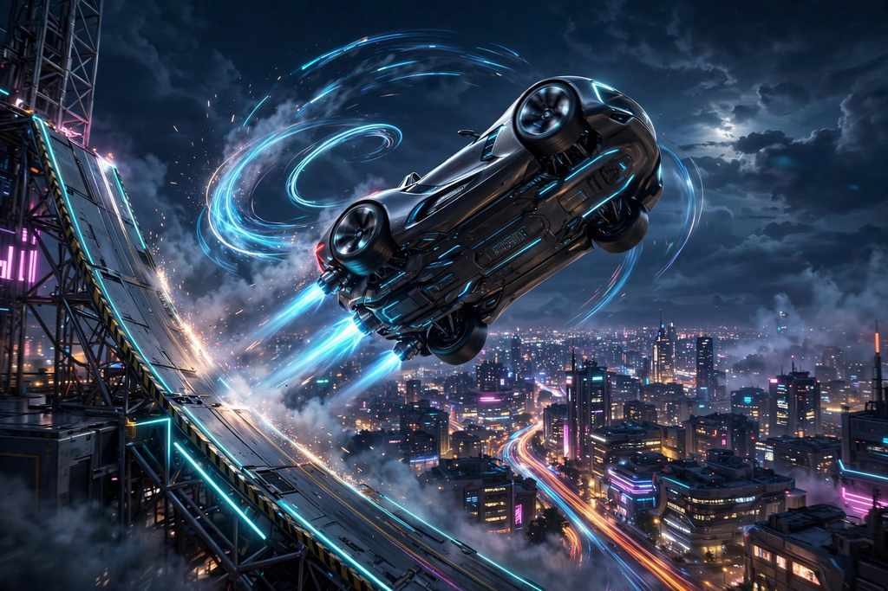

# Flying Car AI Video Generator

**Choose how it flies.**

一张照片 → 飞车 AI 短片 · 按次付费

One-time credit packs, no subscription · prices shown on site before generation

Independent AI video fan tool. Upload only photos you have the rights to. AI results can vary in likeness, motion and detail — concept artwork on this page illustrates the idea, not a guaranteed result.

## Links

|  | URL |
| --- | --- |
| **App** | https://flyingcar-ai.pro |
| **This landing** | https://majiatools.github.io/flying-car-ai/ |

## Demo

Result videos from the template gallery — they illustrate the template motion; your photo and AI result will differ:

- [Ramp stunt](https://flyingcar-ai.pro/videos/ramp-jump.mp4) — the classic ramp launch, climb, airborne stunt and landing
- [Roadster kickflip](https://flyingcar-ai.pro/videos/roadster-kickflip.mp4) — lift, roll and land over the lineup
- [Takeoff & roll](https://flyingcar-ai.pro/videos/vertical-takeoff.mp4) — lift, roll once and return

## What it does

- **1 photo** → a flying-car AI video: ramp launches, airborne rolls and rider stunts
- A gallery of motion templates — ramp stunt, roadster kickflip, ramp side view, roadster liftoff, traffic escape, takeoff & roll, night flight, coastal glide — plus rider templates for bicycle, carriage and skateboard
- Each template supplies the action and camera; **no prompt or reference video to prepare**
- Best input: one clear photo showing the whole subject (car with roofline and wheels visible; full-body rider) rather than a tight crop
- Your own video appears in the Your video area only after a real generation task completes

## How to use

1. Open https://flyingcar-ai.pro and choose a template from the gallery (start with the complete ramp stunt)
2. Upload one clear photo of the whole subject — car, rider, bicycle, carriage or skateboard for its matching template
3. Start the video from your selected template; a finished creation has its own playback and download

## License

Demo media for product showcase. Site © lynsea.
